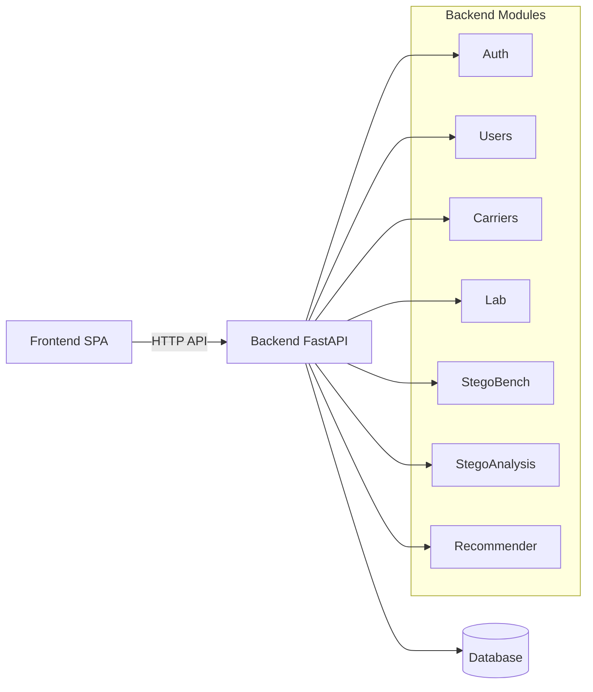

# Architecture Overview

The StegChat system is a **modular monolith** backend built with FastAPI and a **single‑page React** frontend.

```
+-------------------+      +-------------------+      +-------------------+
|   Frontend (SPA) | <--->|   Backend API    |<---->|   Database (SQL) |
+-------------------+      +-------------------+      +-------------------+
```

- **Frontend**: Vite + React 18, TypeScript, Tailwind CSS, TanStack Query for data fetching, Recharts for visualisations.
- **Backend**: FastAPI, Pydantic v2, SQLAlchemy 2.x, Alembic migrations, SQLite by default (configurable to PostgreSQL). The backend provides versioned REST endpoints under `/api/v1`.
- **Modules** (each lives in `backend/app/<module>`):
  - `auth`, `users`, `conversations` – user management (stubs for now).
  - `carriers` – registry of steganography carriers (fake carrier implemented).
  - `lab` – experimental runs, currently only supports the fake carrier.
  - `stegobench`, `steganalysis`, `recommender`, `reports` – future research modules.
- **Data flow**:
  1. Frontend issues a request (e.g., **POST** `/lab/runs`).
  2. Backend validates, uses the carrier registry, writes an `ExperimentRun` row, returns JSON.
  3. Frontend displays the result in a `ResultTable`.

The diagram below (Mermaid) shows the high‑level components.



*The architecture will evolve as additional modules are implemented by the team.*

